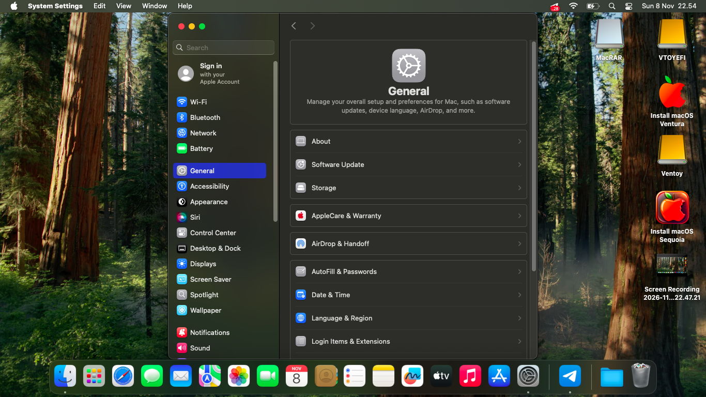
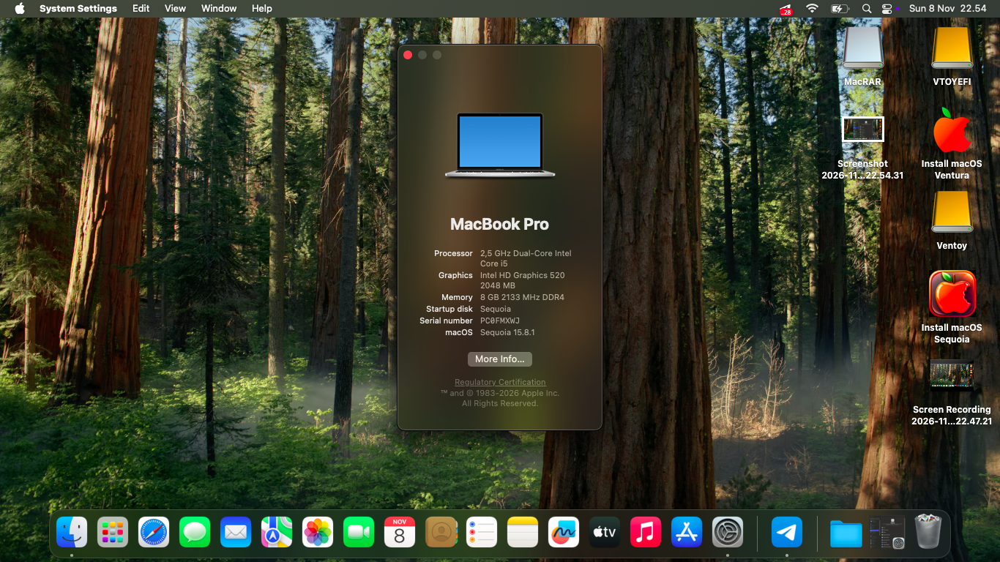

# ThinkPad X260 - OpenCore - Sequoia

OpenCore Source & Guide: [Dortania OpenCore Install Guide](https://dortania.github.io/OpenCore-Install-Guide/) | OpenCore 1.0.4  

Original EFI Base: [ThinkPad X260 6th Gen Skylake](https://github.com/neelakurinji123/Thinkpad-X260-OpenCore)

## Download macOS Sequoia Installer (from this repo)

📥 [macOS Sequoia - Google Drive](https://ouo.io/GzT87v)

EFI ini sudah tested work di Lenovo ThinkPad X260 untuk macOS Ventura, Sonoma & Sequoia 15.x.

## Screenshots Sequoia

## Laptop Specs

- **Model:** Lenovo ThinkPad X260
- **CPU:** Intel Core i5-6300U / i7-6600U (Skylake)
- **GPU:** Intel HD Graphics 520
- **RAM:** 8GB / 16GB DDR4
- **WiFi:** Intel Dual Band Wireless-AC 8260 (Stock) - Works with itlwm
- **Audio:** Realtek ALC293
- **Trackpad:** Synaptics with Gestures

## Download

- **EFI:** Download dari repo ini (**Code > Download ZIP**)
- **macOS Sequoia Installer:** [Google Drive Link](https://ouo.io/GzT87v)

## What's Works (Tested)

- [x] Full Graphics Acceleration
- [x] WiFi via itlwm + HeliPort
- [x] Audio, Mic, Camera
- [x] Keyboard, brightness Fn keys, backlight
- [x] Trackpad + 2/3-finger gestures
- [x] Trackpoint
- [x] Battery indicator & power management
- [x] Sleep / Wake
- [x] Restart / Shutdown

## Not Tested / Expected Fail

- [ ] Bluetooth
- [ ] HDMI / mini DP out
- [ ] Audio jack 3.5mm
- [ ] SD card reader
- [ ] Ethernet via USB dongle
- [ ] AirDrop - expected fail di Intel WiFi

## CHECKLIST TEST X260 SEQUOIA

Legend: ✅ = Tested working | ⏳ = Not tested yet | ⚠️ = Expected fail

- ✅ Wi-Fi - itlwm + HeliPort
- ✅ Brightness (Fn + F5/F6) + slider di Control Center
- ✅ Sound speaker
- ✅ Mic internal (coba record)
- ✅ USB (coba semua port kiri kanan)
- ✅ Touch gesture 2 jari 3 jari (2 jari scroll, 3 jari Mission Control)
- ✅ Restart shutdown
- ✅ Sleep - tutup lid, buka lagi
- ✅ Battery indicator - ngecas & persentase
- ✅ Keyboard backlight (Fn + Space)
- ⏳ HDMI / mini DP out ke monitor
- ✅ Camera FaceTime
- ⏳ Bluetooth - konek ke HP / TWS
- ✅ Trackpoint (pentol merah tengah)
- ⏳ Audio jack 3.5mm
- ⏳ SD card reader
- ⏳ Ethernet (kalau pakai dongle USB)
- ⚠️ AirDrop - expected fail di Intel WiFi

## IMPORTANT - WiFi Fix for Sequoia 15.x

Di Sequoia, `AirportItlwm.kext` bikin Wi-Fi: **No hardware installed**.

Fix yang work di EFI ini:

1. Pakai `itlwm.kext` v2.3.0 Stable
2. Di `config.plist`: `itlwm = Enabled`, `IOSkywalkFamily` & `IO80211FamilyLegacy` = **Disabled**
3. Reset NVRAM (Spasi di OpenCore Picker > Reset NVRAM)
4. Pakai `HeliPort.app` untuk konek WiFi (ada di repo ini)

## Cara Konek WiFi & Auto Start

1. Copy `HeliPort.app` ke `/Applications`
2. Buka dan konek WiFi
3. Auto Start di Sequoia:  
   **System Settings > General > Login Items > + > Add HeliPort**

## Credits

- Dortania Team
- OpenIntelWireless (itlwm & HeliPort)

Enjoy Sequoia on X260!